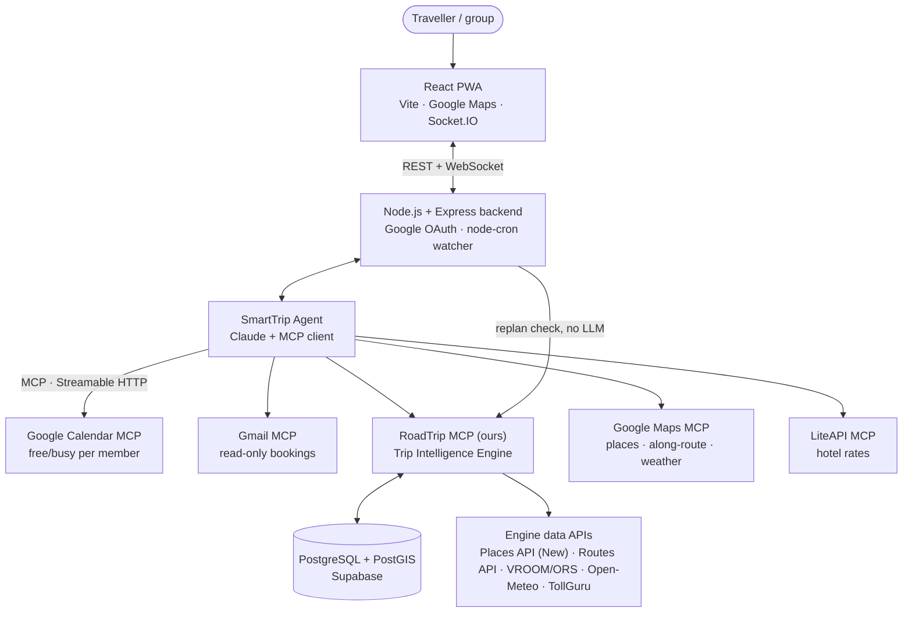
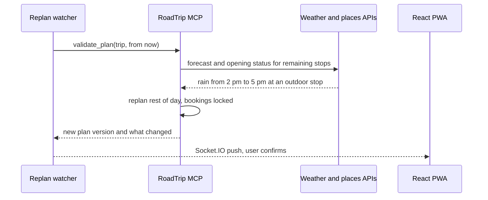

# RoadTrip AI

**MCP-powered trip planning that replans on the road.**

RoadTrip AI connects a traveller's calendar, inbox, maps, weather and hotel data to one AI agent through the [Model Context Protocol (MCP)](https://modelcontextprotocol.io). It finds dates when the whole group is free, builds day-by-day trips that respect opening hours, weather, drive limits and budget, and replans the rest of the day when something changes.

Built for **wHACKiest 2026** (Online Ideathon, 26–27 Nov 2026) · Track: **Make MCP Matter — Less Magic, More Utility**


> **Status:** in development for the hackathon. This README describes the planned design. Setup commands, tool names and folder names may change as the code lands.

## Contents

- [The problem](#the-problem)
- [The solution](#the-solution)
- [Features](#features)
- [How it works](#how-it-works)
- [Architecture](#architecture)
- [MCP servers](#mcp-servers)
- [Tech stack](#tech-stack)
- [Project structure](#project-structure)
- [Getting started](#getting-started)
- [Environment variables](#environment-variables)
- [Privacy and safety](#privacy-and-safety)
- [Roadmap](#roadmap)
- [Known limitations](#known-limitations)
- [Team](#team)
- [Acknowledgements](#acknowledgements)
- [License](#license)

## The problem

**A trip plan depends on calendars, bookings, routes, opening hours, weather and budget — but these live in separate apps that AI planners don't connect, so plans are guesses that break on the road.**

- **Who it affects:** India recorded about 2.95 billion domestic tourist visits in 2024 ([India Tourism Data Compendium 2025](https://tourism.gov.in/sites/default/files/2025-09/India%20Tourism%20Data%20Compendium%202025_1.pdf)): families, friend groups, students and riders.
- **Demand for AI help:** 68% of Indian travellers say they are likely to use AI to plan their next trip, and 33% already do ([Agoda 2026 Travel Outlook](https://www.traveltrendstoday.in/88-of-indian-travellers-trust-or-feel-neutral-about-ai-generated-travel-recommendations-agoda)).
- **Why an LLM alone isn't enough:** in the [TravelPlanner benchmark](https://arxiv.org/abs/2402.01622) (ICML 2024), only 0.6% of GPT-4-Turbo's travel plans met every constraint.
- **Why plans must adapt:** in July 2024, the Shirur landslide shut NH-66 near Ankola for 16 days, and coastal trips had to re-route ([Udayavani](https://udayavani.com/english-news/ankola-national-highway-near-shiruru-reopens-after-landslide-closure)).

Existing tools each solve one piece. Maps apps give routes but no multi-day plan. AI chatbots write itineraries without verifying them. Trip organisers collect bookings, but you still plan by hand, and nothing replans for you.

## The solution

RoadTrip AI is one AI agent (Claude) connected to five MCP servers. Four already exist: Google Calendar, Gmail, Google Maps and LiteAPI. We build the fifth, **RoadTrip MCP**, which holds a deterministic Trip Intelligence Engine.

The core rule is **the LLM proposes, the engine verifies**. Claude understands the request and explains the options. The engine does every calculation (routes, timings, opening hours, weather checks and money), so every plan the user sees has passed hard checks. Each fact in a plan is tagged **Verified**, **Estimated**, **Predicted** or **Unverified**.

## Features

| Feature | What it does | MCP server behind it |
| --- | --- | --- |
| When can we all go? | Overlaps every member's free/busy slots; nobody's event details are shared | Google Calendar MCP · Gmail MCP |
| Stops on your real route | Places matched to your interests along the actual route, ranked by popularity and detour time; places you've visited are skipped | Google Maps MCP |
| Plans that actually hold | Opening hours, weather, daily drive limits, night-travel preference and budget are checked before anything is scheduled | RoadTrip MCP · Google Maps MCP |
| 3–4 explained options | Each option shows why it fits, a day-wise plan, overnight stays and cost per person | RoadTrip MCP · LiteAPI MCP |
| Plan B + live replanning | Rain, a closure, a delay or "skip this stop" → route, ETAs and budget are recomputed; confirmed bookings stay locked | RoadTrip MCP · Google Maps MCP |
| Map, dashboard, offline | The whole route on an interactive map, a live trip dashboard and an itinerary saved for offline use | RoadTrip MCP |

## How it works

1. **Input** — start point, interests, travel mode, group size, budget and (optionally) dates. Each member can connect their own Google Calendar and Gmail.
2. **Understand** — Claude turns the conversation into a validated `TripSpec` (a zod schema).
3. **Gather (MCP)** — free/busy slots, existing bookings, places along the route, weather and hotel rates.
4. **Plan & validate** — RoadTrip MCP ranks stops, schedules each day as a routing problem with time windows, and checks every slot.
5. **Recommend** — 3–4 explained options; the chosen trip is drawn on the map.
6. **Adapt live** — a watcher re-checks weather, closures and ETAs; RoadTrip MCP replans the rest of the day and the app updates over Socket.IO.

### Example request

> "Plan a 4-day road trip with three friends sometime next month. We like nature, scenic routes and adventure. Find dates when we're all free. We'll go by car, about ₹12,000 per person, and we don't want too much driving each day."

RoadTrip AI finds the free dates common to all four calendars, checks Gmail for existing bookings, discovers stops along candidate routes, and returns 3–4 options with day-wise plans, stays and a cost breakdown per person.

## Architecture



### Live replanning



## MCP servers

**Why MCP:** one standard protocol for every tool. The agent discovers tools at runtime, a provider can be swapped without changing agent code, and our engine works in any MCP client (for example, Claude Desktop).

| Server | Used for | Tools we call | Access |
| --- | --- | --- | --- |
| **RoadTrip MCP** (ours) | Planning engine | see the next table | internal, Streamable HTTP |
| **Google Calendar MCP** — open-source [`@cocal/google-calendar-mcp`](https://github.com/nspady/google-calendar-mcp) | Free dates common to the group | `get-freebusy` | `calendar.freebusy` scope, per member |
| **Gmail MCP** — open-source, for example [`@klodr/gmail-mcp`](https://github.com/klodr/gmail-mcp) | Existing hotel and ticket bookings | search and read emails | `gmail.readonly` |
| **Google Maps MCP** — [Maps agent tools](https://developers.google.com/maps/ai/grounding-lite) at `https://mapstools.googleapis.com/mcp` | Places, stops along the route, routes, 10-day weather | `search_places`, `search_along_route`, `compute_routes`, `lookup_weather` | Google Maps Platform API key |
| **LiteAPI MCP** — [LiteAPI](https://docs.liteapi.travel) at `https://mcp.liteapi.travel/api/mcp` | Hotel rates and availability | hotel search and rates | LiteAPI key (free sandbox) |

Google's official Gmail and Calendar MCP servers are in developer preview. We use the open-source servers for now and can switch without changing the agent.

### RoadTrip MCP tools

Working names; they may change during the build.

| Tool | Purpose | Returns |
| --- | --- | --- |
| `find_dates` | Date windows when every member is free | ranked date windows |
| `find_stops` | Places along a route corridor, matched to interests | stops with a score and detour minutes |
| `plan_trip` | Day-by-day itineraries with overnight stays | 3–4 plan options |
| `validate_plan` | Hard-constraint check of a plan | violations: closed place, rain on an outdoor slot, drive time or budget over the limit |
| `estimate_budget` | Itemised cost: fuel, tolls, stays, food, tickets | totals per category and per person, each tagged Verified or Estimated |
| `replan` | Re-solves the rest of a trip after an event | a new plan version and a diff; bookings kept |

## Tech stack

Everything is written in JavaScript. No hardware is used.

| Layer | Tools | Why |
| --- | --- | --- |
| Frontend | React + Vite, Tailwind CSS, `@vis.gl/react-google-maps`, Socket.IO client, PWA (Workbox + IndexedDB) | Quick to build; draws the full route and stops; live replans; the itinerary works offline |
| Backend | Node.js + Express, Socket.IO, zod, node-cron, Helmet, rate limiting | One JavaScript codebase; zod validates every LLM and tool payload; cron re-checks live trips |
| AI | Claude via the Anthropic API (`@anthropic-ai/sdk`): Sonnet for dialogue and explanations, Haiku for reading booking emails | Reliable tool calling; the LLM never computes routes, timings or money |
| MCP | Official MCP SDK (`@modelcontextprotocol/sdk`), Streamable HTTP transport | MCP client inside the agent; MCP server for RoadTrip MCP |
| Trip engine | JavaScript module: ranking, VROOM via OpenRouteService (routing with time windows), Turf.js, validator, budget calculator | Deterministic: the same input gives the same plan |
| Database | PostgreSQL + PostGIS on Supabase, Drizzle ORM, JSONB plan versions | Relational trips and groups; "places within X km of the route" in SQL; undo and audit trail |
| Data APIs | Google Places API (New), Google Routes API (car, two-wheeler), Open-Meteo, TollGuru | India coverage of opening hours and ratings; 16-day forecasts; toll and fuel costs |
| Auth and hosting | Google OAuth 2.0, encrypted token store (AES-256-GCM), Vercel (web), Render (API and MCP), GitHub Actions | Tokens never reach the browser; free tiers deploy in minutes |

## Project structure

Planned layout (Expected):

```
roadtrip-ai/
├── apps/
│   ├── web/              # React + Vite PWA: chat, plan comparison, map, live dashboard
│   └── api/              # Express: REST + Socket.IO, Google OAuth, SmartTrip agent, replan watcher
├── packages/
│   ├── roadtrip-mcp/     # RoadTrip MCP server (official MCP SDK, Streamable HTTP)
│   └── trip-engine/      # ranking, scheduling (VROOM), validation, budget
├── db/                   # Drizzle schema and migrations (PostgreSQL + PostGIS)
├── docs/                 # pitch deck, architecture notes, video script
├── .env.example
└── package.json
```


## Privacy and safety

- Gmail access is read-only (`gmail.readonly`) and optional.
- Calendar access is free/busy only (`calendar.freebusy`), so no event titles or details are read.
- Each group member connects their own account. Other members see only the shared free dates.
- OAuth tokens are encrypted at rest and never sent to the browser.
- Nothing is booked, paid for or added to a calendar without the user's explicit approval.
- A replan never changes a confirmed booking unless the user allows it.
- Users can view, correct or delete their visited places, preferences and connected accounts.


## Known limitations

- `gmail.readonly` is a restricted Google scope. In Testing mode an app is limited to 100 users, and a public launch needs Google's app verification plus a security assessment.
- We haven't found an official public API for Indian train and bus schedules, so those legs are estimates and are labelled as such.
- Amadeus closed its self-service APIs on 17 July 2026, so hotel rates come from LiteAPI.
- Google's official Gmail and Calendar MCP servers are in developer preview, so the open-source servers are used for now.
- Two-wheeler routes in the Google Routes API are in beta.
- Open-Meteo's free API is for non-commercial use only; a commercial launch needs a paid plan.

## Team

| Member |
| --- |
| Kushvendra Singh Rathore (Lead) |
| Shivaraj Shegunasi |
| Ayush Ojha |
| Saish Kelvekar |

## Acknowledgements

- [Model Context Protocol](https://modelcontextprotocol.io) and its official SDKs
- [Claude](https://www.anthropic.com) by Anthropic
- [Google Maps Platform](https://developers.google.com/maps)
- [openrouteservice](https://openrouteservice.org) and VROOM; map data © OpenStreetMap contributors
- Weather data by [Open-Meteo.com](https://open-meteo.com) (CC BY 4.0)
- [TollGuru](https://tollguru.com), [LiteAPI](https://docs.liteapi.travel) and [Supabase](https://supabase.com)

## License

This project is licensed under the MIT License. See [LICENSE](LICENSE).
